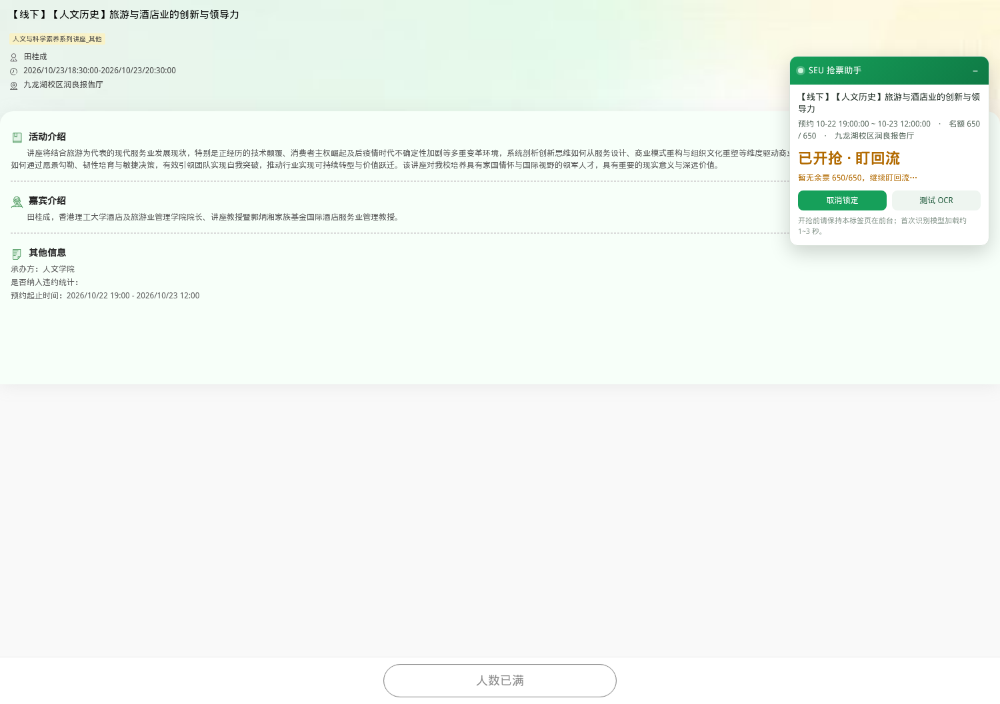

# SEU 讲座抢票助手

东南大学「素质讲座」详情页的 Chrome / Edge 浏览器插件。

手动打开讲座详情页 → 插件识别讲座 → 点一下「锁定本场」→ 预约开放瞬间自动提交。
验证码使用 ddddocr 模型**在浏览器本地识别**，图片不离开本机；插件不保存、不上传账号密码。



- Manifest V3，无后端、无第三方服务
- 本地 OCR（onnxruntime-web + ddddocr 模型，wasm 运行）
- 只在 `ehall.seu.edu.cn` 的讲座系统页面工作

> 本项目仅用于个人预约，不绕过学校的任何规则或限制。能否预约成功最终以「我的活动」中的入场券为准。

---

## 功能

| 功能 | 说明 |
| --- | --- |
| 详情页自动识别 | 打开 `#/hdxq?WID=...` 详情页后面板自动出现，显示标题、预约窗口、名额 |
| 服务器时间对时 | 用详情接口返回的 `NOW` 校准本机时钟，不受电脑时间误差影响 |
| 精准开抢 | 开抢前 1 分钟提醒并预热模型，提前约 1.5 秒取验证码并识别，到点立即提交 |
| 自动重试 | 验证码识别错误、未开放、名额已满等情况自动换验证码重试 |
| 回流票监控 | 开抢 5 秒后按剩余名额轮询，有人退票立即提交；默认盯到预约截止（可关闭） |
| 本地验证码识别 | 识别过程完全在浏览器内完成，不请求任何第三方 OCR 接口 |
| 成功提醒 | 页面标题变为「✅ 已抢到 …」，同时播放提示音、弹出系统通知 |
| 单场锁定 | 一次只锁定一场讲座，换页误点不会顶掉已锁定的场次 |

## 安装

### Chrome

1. 下载本仓库（`Code` → `Download ZIP`），或用 `git clone`。
2. 打开 `chrome://extensions`。
3. 打开右上角的「开发者模式」。
4. 点击「加载已解压的扩展程序」，选择包含 `manifest.json` 的目录。
5. 工具栏出现绿色图标即安装成功（可在扩展菜单中固定）。

### Edge

步骤相同，扩展管理页为 `edge://extensions`，同样开启「开发人员模式」后加载。

> 如果下载的是 ZIP，请先解压再选择目录。未打包的扩展 ID 与目录绝对路径绑定，移动目录后需要在扩展页重新加载。

## 使用

1. 在浏览器中正常登录 `ehall.seu.edu.cn`，进入 **素质讲座** 列表。
2. 点进想预约的讲座 **详情页**（地址中包含 `#/hdxq?WID=...`）。
3. 右上角会出现「SEU 抢票助手」面板，核对标题、预约时间和名额。
4. 点击 **锁定本场**：
   - 面板显示倒计时；
   - 开抢前 1 分钟会发出提醒并提前加载识别模型；
   - 到点自动完成「取验证码 → 本地识别 → 提交预约」。
5. **抢票期间请保持该详情页在前台**。Chrome 会节流后台标签页的定时器，切走可能错过开抢。
6. 成功后页面标题会变成「✅ 已抢到 …」，并弹出系统通知。

工具栏图标中的弹窗也可以锁定/取消锁定，并可勾选「开抢后继续盯回流票直到预约截止」。

### 建议

- 第一次使用时，可以先在面板里点 **测试 OCR**，确认模型能正常加载和识别。
- 提前几分钟打开详情页并锁定，不要等到开抢前几秒才操作。
- 抢票期间不要最小化窗口，也不要让标签页进入后台（包括切到其他标签、打开全屏应用）。
- 如果显示「已锁定另一场」，先在原讲座页取消锁定，或在弹窗中取消。

## 工作原理

```
┌──────────────────────────── Chrome 扩展 ────────────────────────────┐
│                                                                     │
│  content.js（讲座详情页）                                           │
│   ├─ 读取 #/hdxq?WID=...                                            │
│   ├─ POST getActivityDetail.do  ← 标题/预约窗口/名额/服务器时间     │
│   ├─ Shadow DOM 面板：倒计时、状态、锁定按钮                        │
│   └─ 到点：取验证码 → OCR → POST addReservation.do                 │
│                    │                  ▲                             │
│                    ▼                  │                             │
│  background.js（Service Worker）      │                             │
│   ├─ 保存锁定状态（chrome.storage）   │                             │
│   ├─ 开抢前 1 分钟闹钟（chrome.alarms）                             │
│   ├─ 系统通知（chrome.notifications） │                             │
│   └─ 消息转发 ────────────────────────┘                             │
│                    │                                                │
│                    ▼                                                │
│  offscreen.js（Offscreen Document）                                 │
│   └─ onnxruntime-web + common_old.onnx：本地识别验证码              │
└─────────────────────────────────────────────────────────────────────┘
```

关键时序（`T` 为预约开放时刻）：

| 时间 | 动作 |
| --- | --- |
| `T - 60s` | 后台闹钟唤醒，发送开抢提醒，开始在 offscreen 中预热 OCR 模型 |
| `T - 1.5s` | 预取一张验证码并完成识别 |
| `T` | 提交预约，失败则换一张验证码重试 |
| `T + 5s` | 开始查询 `YYRS / HDZRS`，满员时降频盯回流票 |
| `YYJSSJ` | 预约截止，停止监控（可在弹窗中关闭持续监控） |

使用的接口（同源、依赖浏览器内的登录 Cookie）：

| 接口 | 用途 |
| --- | --- |
| `POST /gsapp/sys/yddjzxxtjappseu/modules/hdyy/getActivityDetail.do` | 讲座详情、预约窗口、剩余名额、服务器时间 |
| `GET /gsapp/sys/yddjzxxtjappseu/modules/hdyy/vcode.do` | 获取验证码图片 |
| `POST /gsapp/sys/yddjzxxtjappseu/modules/hdyy/addReservation.do` | 提交预约（`wid` + `vcode`） |

验证码识别流程：按高度 64 等比缩放 → 灰度化 → 归一化 → CTC 贪心解码，与 ddddocr 的预处理保持一致。

## 权限说明

| 权限 | 用途 |
| --- | --- |
| `host_permissions: https://ehall.seu.edu.cn/*` | 只在讲座系统中读取详情、获取验证码、提交预约 |
| `storage` | 保存锁定的讲座和设置 |
| `alarms` | 开抢前 1 分钟提醒 |
| `notifications` | 成功、失败、开抢提醒 |
| `offscreen` | 在独立页面中运行 wasm OCR 模型 |

插件不会读取其他网站，不收集、不上传任何数据。

## 隐私与安全

- 插件不包含任何账号、密码或 Cookie；登录完全由学校页面自己处理。
- 验证码图片只在浏览器内存中处理，不会发送到任何服务器。
- 锁定的讲座信息保存在 `chrome.storage.local`，仅本机可见。
- 使用前请确认符合学校对讲座预约的相关规定。

## 常见问题

**面板没有出现？**
确认当前地址是讲座详情页（包含 `#/hdxq?WID=...`），并在 `chrome://extensions` 中确认插件已启用。安装或更新插件后，需要刷新已经打开的详情页。

**提示「已锁定另一场」？**
插件一次只锁定一场讲座。回到原来那场详情页点击「取消锁定」，或在工具栏弹窗中取消后再锁定新场次。

**提示「暂无余票，继续盯回流」？**
说明名额已满，插件会持续查询余量，有人退票时会自动尝试提交。默认持续到预约截止时间。

**识别成功但预约失败？**
验证码可能已被使用或识别错误，插件会自动换一张重试。若接口提示其他错误，面板会显示原因。

**电脑时间不准会影响吗？**
不会。插件以详情接口返回的服务器时间 `NOW` 为准，并在每次刷新详情时重新校准。

**学校接口变更后还能用吗？**
如果页面地址、接口路径或字段发生变化，插件需要相应更新。请在 Issues 中反馈。

## 已知限制

- 验证码识别不是 100%，失败时会自动重试。
- 抢票时标签页必须在前台，最小化窗口也可能被节流。
- 只支持东南大学讲座系统；其他学校需要自行适配接口。
- 最终预约结果以「我的活动」中显示的入场券为准。

## 目录结构

```
manifest.json          Manifest V3 配置
background.js          Service Worker：锁定状态、闹钟、通知、消息转发
content.js             详情页识别、Shadow DOM 面板、倒计时、抢票循环
popup.html / popup.js  工具栏弹窗
offscreen.html/.js     本地 OCR（onnxruntime-web + ddddocr 模型）
vendor/                onnxruntime-web wasm 运行时
model/                 common_old.onnx + charset.json
icons/                 插件图标
docs/images/           README 截图
```

## 开发与打包

修改代码后，在 `chrome://extensions` 点击插件卡片上的刷新按钮即可；内容脚本的修改还需要刷新讲座页面。

打包：

```bash
zip -r SEU_Grab_Extension.zip . -x '*.git*' -x '*.DS_Store'
```

## 致谢

- 讲座预约流程与接口字段的探索参考了 [ApricityWang/SEU_Lecture_Reserve](https://github.com/ApricityWang/SEU_Lecture_Reserve)（东南大学讲座自动预约脚本）。
- 验证码识别模型与字符集来自开源项目 [ddddocr](https://github.com/sml2h3/ddddocr)。
- 验证码推理使用 [onnxruntime-web](https://github.com/microsoft/onnxruntime)。

感谢以上项目的作者与贡献者。

## 免责声明

本项目仅供学习与个人使用。请遵守东南大学讲座预约的相关规定，不要用于代抢、批量抢票或其他不当用途。使用本插件产生的一切后果由使用者自行承担。
